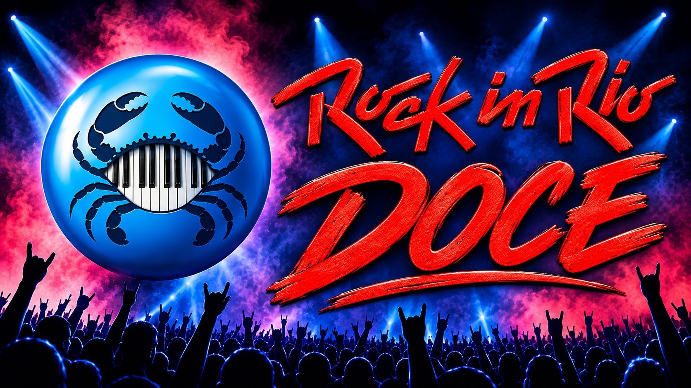
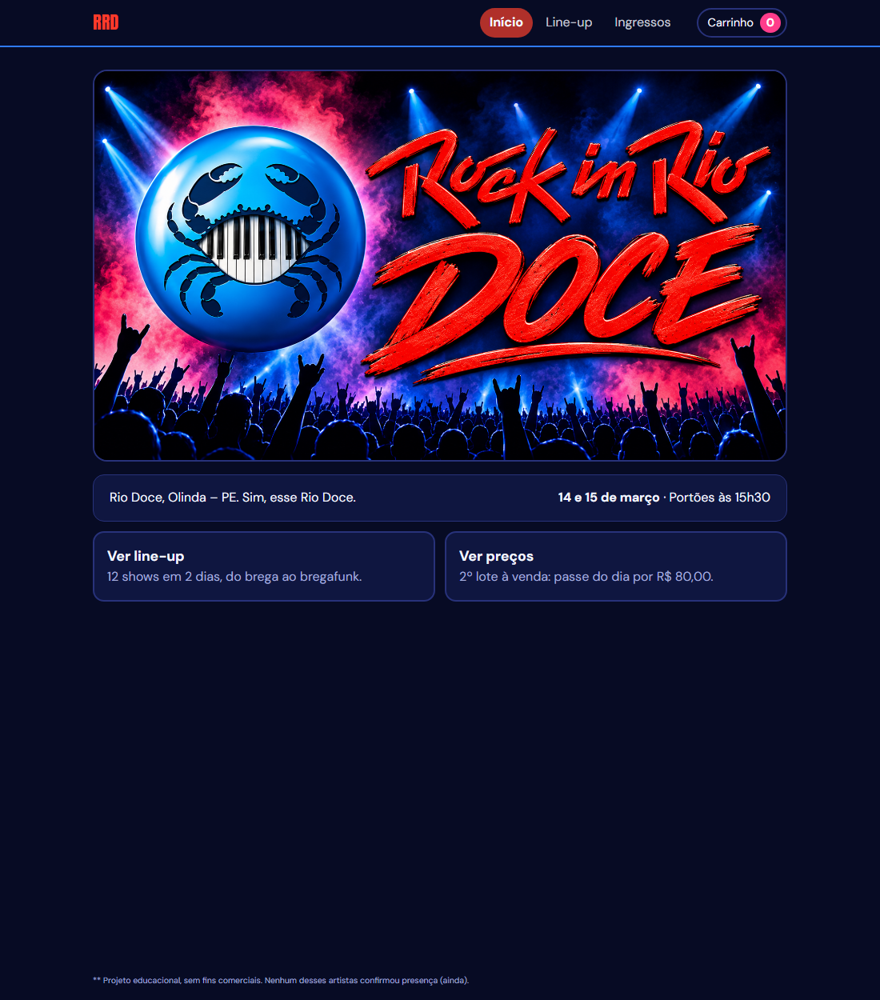
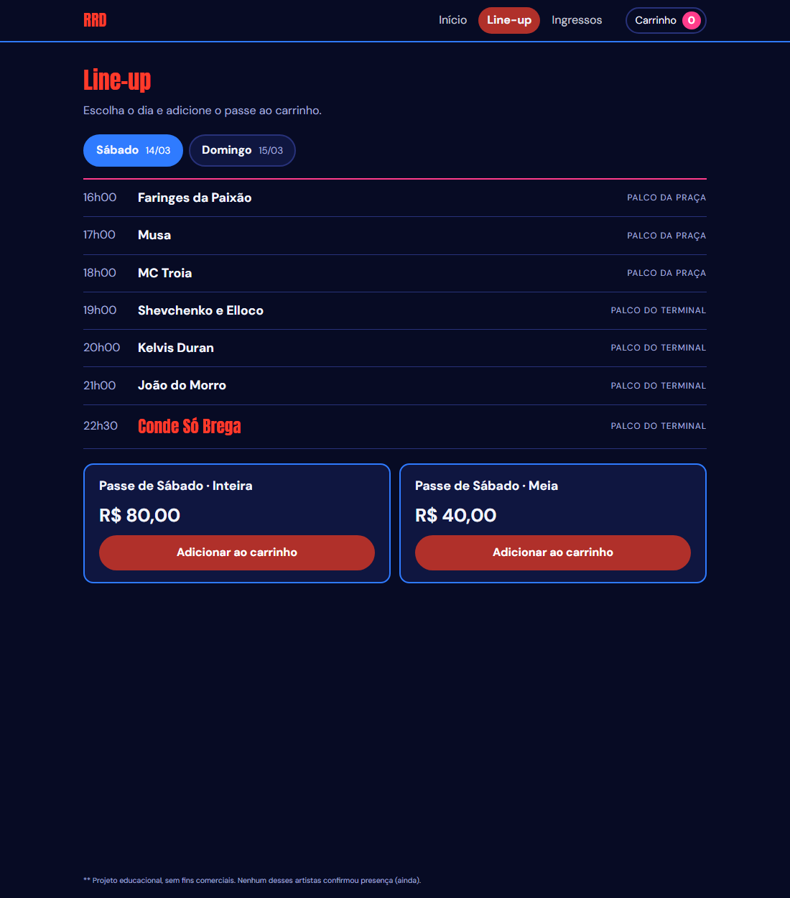
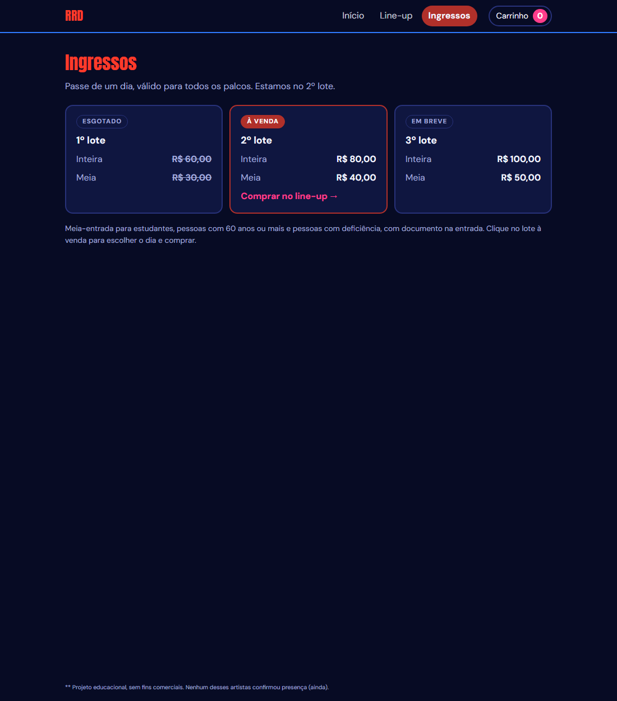
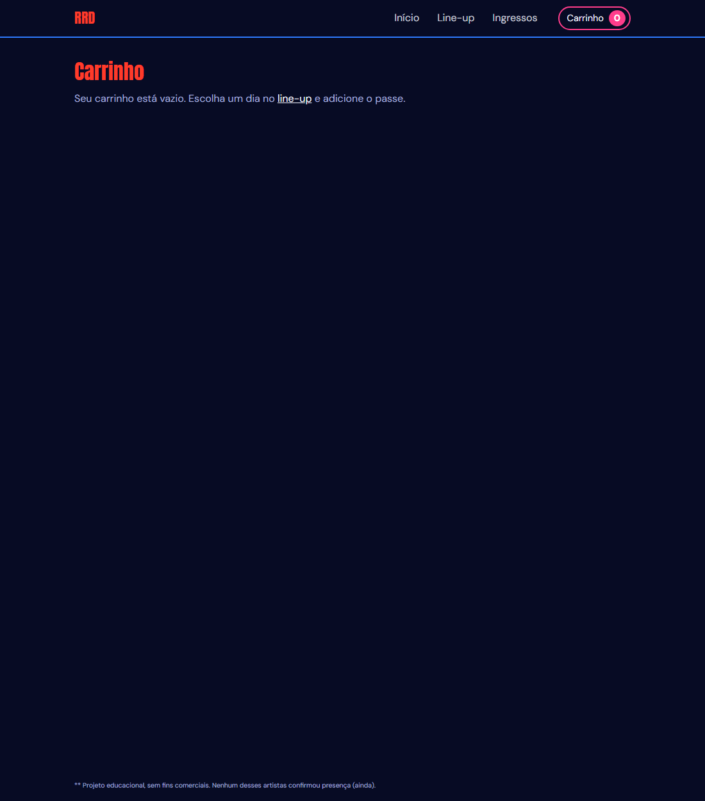

# Rock in Rio Doce 🦀

O maior festival que nunca aconteceu, em Rio Doce, Olinda – PE. Sim, esse Rio Doce.

Neste projeto você vai construir o site do festival com **React**. No caminho, vai praticar:

- **Navegação** entre páginas com React Router
- **Estado local** com `useState`
- **Estado global** com Context API (o carrinho)
- Listas com `map` e componentes com props

---

## O que você recebe

| Arquivo | O que é |
|---|---|
| `src/index.css` | Todo o visual do site, pronto. **Não precisa escrever CSS.** |
| `public/banner.png` | A imagem do topo da página inicial |
| `src/data/festival.js` | Os dados do festival: dias, shows, lotes e a função `formatarPreco` |

Seu trabalho é criar os componentes React usando os **nomes de classe** que já existem no CSS. Eles estão listados em cada passo.

---

## As páginas finais

O site tem um cabeçalho e um rodapé fixos, e 4 páginas.

| Página | Endereço | Imagem |
|---|---|---|
| Início | `/` | [docs/telas/inicio.png](docs/telas/inicio.png) |
| Line-up | `/lineup` | [docs/telas/lineup.png](docs/telas/lineup.png) |
| Ingressos | `/ingressos` | [docs/telas/ingressos.png](docs/telas/ingressos.png) |
| Carrinho | `/carrinho` | [docs/telas/carrinho.png](docs/telas/carrinho.png) |

 
 

---

## Como o site funciona

Use esta lista para conferir se o seu site está completo.

**Em todas as páginas**
- [ ] O cabeçalho mostra o logo **RRD**, os links Início, Line-up e Ingressos, e o botão **Carrinho** com a quantidade de passes.
- [ ] O link da página atual fica destacado em vermelho.
- [ ] O número do carrinho muda na hora quando um passe é adicionado ou removido.
- [ ] O rodapé fica sempre no fim da tela, com o texto "\*\* Projeto educacional...".

**Início**
- [ ] Mostra o banner, o local e a data.
- [ ] Tem dois atalhos: **Ver line-up** (vai para `/lineup`) e **Ver preços** (vai para `/ingressos`).

**Line-up**
- [ ] Duas abas: Sábado e Domingo. Clicar numa aba troca a lista de shows.
- [ ] O último show de cada dia (quem fecha a noite) aparece em destaque.
- [ ] Abaixo da lista há 2 cards: **Inteira** e **Meia**, cada um com o preço do lote atual e o botão **Adicionar ao carrinho**.
- [ ] Ao adicionar, aparece a mensagem "Passe de Sábado (Meia) adicionado." com o link **Ir para o carrinho**.

**Ingressos**
- [ ] Mostra 3 cards de lote com o preço da inteira e da meia.
- [ ] O 1º lote está esgotado (preço riscado). O 3º lote está "em breve".
- [ ] Clicar no card do lote **à venda** leva para o Line-up.

**Carrinho**
- [ ] Vazio: mostra a mensagem "Seu carrinho está vazio" com link para o Line-up.
- [ ] Com passes: lista cada passe (dia, tipo e preço) com o botão **Remover**.
- [ ] Mostra o **total** em reais.
- [ ] O botão **Reservar** esvazia o carrinho e mostra "Reserva feita. Te vejo em Rio Doce!".

---

## Roteiro

Faça um passo de cada vez e confira no navegador antes de seguir.

### Passo 0 · Preparar o projeto

```bash
npm install
npm install react-router-dom@6
npm run dev
```

Abra o endereço que aparecer no terminal (normalmente `http://localhost:5173`).

No `index.html`, coloque o título `Rock in Rio Doce` e as fontes do Google dentro do `<head>`:

```html
<link rel="stylesheet" href="https://fonts.googleapis.com/css2?family=Anton&family=DM+Sans:opsz,wght@9..40,400;9..40,500;9..40,700&display=swap" />
```

### Passo 1 · Criar as pastas

```
src/
├── components/   Header.jsx, Footer.jsx
├── pages/        Inicio.jsx, Lineup.jsx, Ingressos.jsx, Carrinho.jsx
├── context/      FestivalContext.jsx
├── data/         festival.js   (você recebe pronto)
├── App.jsx
├── main.jsx
└── index.css     (você recebe pronto)
```

Crie cada página primeiro só com um título, por exemplo `<h2>Line-up</h2>`, para testar a navegação.

### Passo 2 · Navegação

1. No `main.jsx`, envolva o `<App />` com `<BrowserRouter>`.
2. No `App.jsx`, coloque `<Header />`, depois um `<main className="container">` com as `<Routes>`, e por fim `<Footer />`.
3. Crie uma `<Route>` para cada endereço: `/`, `/lineup`, `/ingressos` e `/carrinho`.
4. No `Header`, use `<NavLink>` nos links. O NavLink coloca a classe `active` sozinho na página atual, e o CSS já sabe destacar.

Classes: `header`, `container`, `header-conteudo`, `logo`, `menu`, `botao-carrinho`, `contador`, `footer`.

✅ Teste: clicar nos links troca a página, e o link da página atual fica vermelho.

### Passo 3 · Páginas Início e Ingressos

Essas páginas só **leem** os dados de `festival.js`. Não têm estado.

- **Início**: banner, faixa de informações e dois `<Link>` de atalho.
  Classes: `pagina`, `banner`, `info`, `atalhos`, `atalho`.
- **Ingressos**: use `lotes.map(...)` para criar um card por lote. O lote com `atual: true` deve ser um `<Link to="/lineup">`. Os outros são uma `<div>`.
  Classes: `lotes`, `lote`, `lote-atual`, `lote-esgotado`, `etiqueta`, `linha-preco`, `chamada`, `observacao`.

💡 Dica: crie um componente `CardLote` que recebe `lote` por props, para não repetir o conteúdo do card.

### Passo 4 · Line-up com estado local

A aba escolhida só importa para esta página, então ela é **estado local**:

```jsx
const [diaEscolhido, setDiaEscolhido] = useState(0) // 0 = Sábado, 1 = Domingo
const dia = dias[diaEscolhido]
```

- Use `dias.map(...)` para criar os botões das abas. A aba escolhida recebe `aba aba-ativa`, e as outras só `aba`.
- Use `dia.shows.map(...)` para criar a lista. O show com `destaque: true` recebe `show show-destaque`.
- Crie os 2 cards de passe (inteira e meia) com o preço de `loteAtual`. Por enquanto, os botões ainda não fazem nada.

Classes: `descricao`, `abas`, `aba`, `aba-ativa`, `lista-shows`, `show`, `show-destaque`, `horario`, `artista`, `palco`, `cards-passe`, `card-passe`, `preco`, `botao`.

✅ Teste: clicar em Domingo mostra os shows de domingo.

### Passo 5 · O carrinho no Context

O carrinho é usado no **Header**, no **Line-up** e no **Carrinho**. Em vez de passar props de um para o outro, guardamos ele num **Context**.

Em `context/FestivalContext.jsx`:

1. Crie o contexto com `createContext()`.
2. Crie o componente `FestivalProvider`, com `const [carrinho, setCarrinho] = useState([])`.
3. Crie as funções:
   - `adicionarPasse(dia, tipo, preco)`: cria `{ id: Date.now(), dia, tipo, preco }` e faz `setCarrinho([...carrinho, novoPasse])`.
   - `removerPasse(id)`: `setCarrinho(carrinho.filter((passe) => passe.id !== id))`.
   - `limparCarrinho()`: `setCarrinho([])`.
4. Calcule o `total` somando o `preco` de cada passe.
5. Entregue tudo no `value` do Provider.
6. Exporte um atalho: `export function useFestival() { return useContext(FestivalContext) }`.

No `main.jsx`, envolva o `<App />` com `<FestivalProvider>`, dentro do `<BrowserRouter>`.

### Passo 6 · Ligar o Context nas páginas

- **Header**: pegue `carrinho` com `useFestival()` e mostre `carrinho.length` no contador.
- **Line-up**: pegue `adicionarPasse` e chame no `onClick` de cada card. Depois, mostre a mensagem de aviso (outro `useState`) com um `<Link to="/carrinho">`.
  Classe da mensagem: `aviso`.

✅ Teste: adicione passes no Line-up e veja o número do carrinho subir. Troque de página: o número continua lá. **É isso que o Context resolve.**

### Passo 7 · Página Carrinho

Pegue `carrinho`, `total`, `removerPasse` e `limparCarrinho` com `useFestival()`. A página tem 3 situações:

1. **Reservado** (um `useState(false)` local): mostra a mensagem de sucesso.
2. **Vazio** (`carrinho.length === 0`): mostra a mensagem com o link para o Line-up.
3. **Com passes**: lista com `carrinho.map(...)` (use `passe.id` como `key`), o total e o botão Reservar.

Classes: `itens-carrinho`, `item-carrinho`, `botao-remover`, `total`.

✅ Teste: adicione 2 inteiras e 1 meia. O total deve ser R$ 200,00. Remova uma e veja o total mudar.

---

## Desafios extras

1. Mostre no card **Ver preços** da página inicial quantos passes já estão no carrinho.
2. Agrupe passes iguais no carrinho ("2 × Passe de Sábado · Inteira") em vez de repetir a linha.
3. Salve o carrinho no `localStorage` para ele não sumir ao recarregar a página.

---

## Comandos

| Comando | O que faz |
|---|---|
| `npm run dev` | Abre o site em modo de desenvolvimento |
| `npm run build` | Gera a versão final na pasta `dist` |
| `npm run lint` | Procura erros no código |

---

\*\* Projeto educacional, sem fins comerciais. Nenhum desses artistas confirmou presença (ainda).
